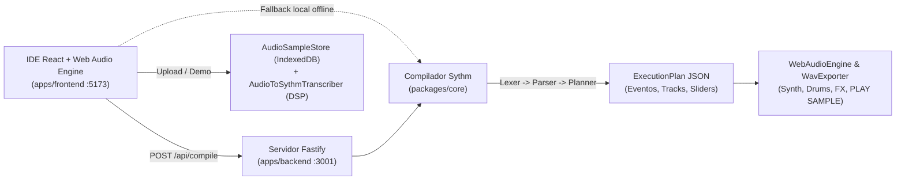

<div align="center">

# Sythm

**Linguagem de programação musical declarativa inspirada no COBOL, combinada com live coding estilo Strudel e uma IDE Web completa sobre Web Audio API.**

[](./LICENSE)
[](https://www.typescriptlang.org/)
[](https://react.dev/)
[](https://fastify.dev/)
[](https://developer.mozilla.org/en-US/docs/Web/API/Web_Audio_API)
[](https://pnpm.io/)
[](https://vitest.dev/)

[Visão Geral](#visão-geral) •
[Funcionalidades](#funcionalidades) •
[Arquitetura](#arquitetura-do-monorepo) •
[Como Executar](#como-executar-localmente) •
[Guia de Sintaxe](#guia-rápido-da-sintaxe-sythm) •
[API HTTP](#api-http-do-backend-sythmbackend) •
[Contribuindo](#contribuindo) •
[Licença](#licença)

</div>

---

## Visão Geral

O **Sythm** transforma a composição musical e o *live coding* em código legível e estruturado:

- **Estrutura declarativa em Divisões** (`HEADER DIVISION.`, `CONFIG DIVISION.`, `PROCEDURES DIVISION.` e `PLAY DIVISION.`), onde cada instrução termina com ponto final (`.`) e comentários começam com `*>`.
- **Controles interativos estilo Strudel** direto no código (`CONTROL ... IS SLIDER ... FROM ... TO ...`) que geram sliders no editor e no **Track Mixer** para modular volume, filtro, reverb, delay e panorama em tempo real sem interromper o áudio.
- **IDE Web integrada** inspirada no Xcode / VS Code, com compilador híbrido (backend Fastify ou fallback 100% local no navegador via `@sythm/core`), visualizador triplo, importador/transcritor DSP de áudio externo, exportação `.WAV` e um **livro tutorial interativo de 12 capítulos**.

---

## Funcionalidades

### Linguagem & Compilador (`@sythm/core`)
- **Arquitetura em Divisões**: `HEADER` (metadados), `CONFIG` (BPM, escala, instrumento padrão, visualizador e sliders), `PROCEDURES` (sub-rotinas `SECTION ... END-SECTION.`) e `PLAY` (`TRACK ... END-TRACK.` paralelas).
- **Teoria Musical e Algoritmos**:
  - Notas e oitavas (`C4`, `Eb2`, `F#5`), sequências (`PLAY NOTES`), acordes e cifras reais (`Cmaj7`, `F#m7`, `Bb`, `Cm9`, `PLAY CHORDS`).
  - Travamento tonal por escala (`SCALE IS C MINOR`, `MAJOR`, `PENTATONIC`, `DORIAN`, `BLUES`, etc.).
  - Arpejador inteligente (`ARPEGGIATE <ACORDE> UP | DOWN | UP-DOWN | RANDOM FOR <N> BEATS.`).
  - Gerador matemático de **Ritmos Euclidianos** (`PLAY EUCLIDEAN <ALVO> <PULSOS> IN <PASSOS> FOR <N> BEATS.`).
- **Modularidade**: Loops `REPEAT <N> TIMES ... END-REPEAT.` e chamadas reutilizáveis `PERFORM <SECTION> <N> TIMES.`, além de diagnóstico léxico/sintático com linha e coluna e logs musicais com `PRINT "..."` / `DISPLAY "..."`.

### Motor de Síntese Web Audio & Studio (`@sythm/frontend`)
- **4 Formas de Onda Analógicas**: `SINE`, `TRIANGLE`, `SQUARE`, `SAW`.
- **5 Sintetizadores Compostos**: `FM-KEYS` (piano elétrico FM), `ACID-BASS` (estilo 303), `SUB-808`, `PLUCK` (corda dedilhada) e `PAD-WARM`.
- **Drum Machine de 10 Peças**: `KICK`, `SNARE`, `HIHAT`, `OPEN-HIHAT`, `CLAP`, `TOM`, `RIM`, `COWBELL`, `CRASH`, `PERC`.
- **Cadeia de Efeitos & Modulação por Track**:
  - `FILTER IS LOWPASS | HIGHPASS | BANDPASS <HZ> [Q <N>].`
  - `SWEEP FROM <HZ> TO <HZ> OVER <BEATS> BEATS.`
  - `LFO IS ON RATE <HZ> DEPTH <HZ>.`
  - `ENVELOPE ATTACK <S> SEC DECAY <S> SEC SUSTAIN <%> PERCENT RELEASE <S> SEC.`
  - `DELAY IS <%> PERCENT TIME <S> SEC FEEDBACK <%> PERCENT.`
  - `REVERB IS <%> PERCENT.`, `DETUNE IS <N> CENTS.` e `PAN IS LEFT|RIGHT|CENTER <%> PERCENT.`
- **Track Mixer ao Vivo**: Barras de nível e botões individuais de **Mute (`M`)** e **Solo (`S`)** por faixa, além de sliders sincronizados bidirecionalmente com o código-fonte.

### Áudio Externo, Sampler (`PLAY SAMPLE`) & Transcritor DSP
- **Importar Áudio (`.mp3`, `.wav`, `.ogg`, `.m4a`, `.webm`)**: Persistência local no navegador via `IndexedDB` e botão **Gerar Demo Loop** (`demo-rave-loop.wav` a `128 BPM`) para testar imediatamente sem arquivos externos.
- **3 Modos de Integração no Importador**:
  1. **Áudio Base (`PLAY SAMPLE`)**: Toca o áudio original sincronizado com `VOLUME`, `FILTER`, `REVERB`, `DELAY`, `PAN` e sliders `CONTROL`.
  2. **Converter em Código**: Analisador DSP (`AudioToSythmTranscriber`) estima BPM, escala musical, hits de bateria em 3 bandas (`KICK`, `SNARE`, `HIHAT`), linha de baixo e melodia por autocorrelação, gerando um programa `.sythm` puro.
  3. **Híbrido (Áudio + Código)**: Mixa a `TRACK AUDIO-ORIGINAL` em paralelo com as tracks extraídas sincronizadas.
- **DJ Remix, Speed-Up & Slicer**: Controle de velocidade/pitch (`RATE <0.25 a 4.0>`) e fatiamento por tempo (`OFFSET <S> SEC`) diretamente no comando `PLAY SAMPLE`.

### Experiência Completa de IDE
- **Visualizador Triplo em Tempo Real**: Osciloscópio (`SCOPE`), analisador de espectro FFT (`SPECTRUM`) e `PIANOROLL` interativo (`VISUALIZER IS ALL | SCOPE | SPECTRUM | PIANOROLL | OFF`).
- **Exportação Offline `.WAV`**: Renderização estéreo limpa fora do tempo real via `OfflineAudioContext` (`WavExporter`).
- **Gerenciamento de Projetos**: Sidebar com criação de arquivos `.sythm`, pastas virtuais e compartilhamento compacto via URL.
- **Temas & Customização Estilo VS Code**: 7 temas integrados (*Xcode Dark*, *VS Code Dark+*, *Dracula*, *Monokai Pro*, *Cyberpunk Neon*, *GitHub Dark*, *Solarized Ocean*) mais criador de tema personalizado e preferências de editor.
- **Sythm Tutorial Integrado**: Manual em formato de livro paginado com **12 capítulos**, sumário navegável, inserção de trechos no cursor e carregamento de exemplos completos no editor.

---

## Arquitetura do Monorepo



### Estrutura de Diretórios

```text
Sythm/
├── apps/
│   ├── backend/                         # API HTTP Fastify 5 (@sythm/backend)
│   │   └── src/
│   │       ├── main.ts                  # Bootstrap na porta 3001
│   │       └── infrastructure/http/     # Rotas /api/health, /api/presets e /api/compile
│   └── frontend/                        # IDE Web React 19 + Tailwind v4 (@sythm/frontend)
│       └── src/
│           ├── infrastructure/
│           │   ├── api/                 # CompilerClient com fallback local
│           │   ├── audio/               # WebAudioEngine, SythmSynthGraph, WavExporter, AudioSampleStore, AudioToSythmTranscriber
│           │   └── storage/             # ProjectStorage e SettingsStorage (localStorage)
│           └── presentation/components/ # CodeEditor, TrackMixerBar, AudioVisualizerBar, AudioImportModal, SythmTutorialModal, SettingsModal, DebugArea, ProjectNavigator, XcodeToolbar
├── packages/
│   └── core/                            # Núcleo compilador em Clean Architecture (@sythm/core)
│       ├── src/
│       │   ├── domain/                  # Token, Ast, ExecutionPlan, ChordParser, NoteFrequency
│       │   ├── application/             # Portas (ILexer, IParser, IExecutionPlanner) e CompileSythmCodeUseCase
│       │   └── infrastructure/          # CobolStyleLexer, CobolStyleParser, TimelineExecutionPlanner, DefaultPresets
│       └── tests/                       # Suíte Vitest (compiler.test.ts)
├── .github/                             # CI GitHub Actions e templates de Issue/PR
├── .editorconfig                        # Padronização de formatação
├── CHANGELOG.md
├── CODE_OF_CONDUCT.md
├── CONTRIBUTING.md
├── LICENSE                              # Licença MIT
├── SECURITY.md
├── package.json                         # Scripts do workspace pnpm
└── pnpm-workspace.yaml
```

---

## Como Executar Localmente

### Pré-requisitos

- **Node.js** `>= 20.0.0`
- **pnpm** `>= 9.0.0`

### Instalação e Execução

```bash
# 1. Clone o repositório
git clone https://github.com/<esc4n0rx>/Sythm.git
cd Sythm

# 2. Instale as dependências do monorepo
pnpm install

# 3. Compile o @sythm/core e inicie backend + frontend juntos
pnpm dev
```

Após subir o ambiente:
- **IDE Web (Frontend Vite):** [http://localhost:5173](http://localhost:5173)
- **API de Compilação (Backend Fastify):** [http://localhost:3001](http://localhost:3001)

> [!NOTE]
> O `vite.config.ts` encaminha chamadas `/api` para `http://localhost:3001`. Caso apenas o frontend esteja rodando, o `CompilerClient` aciona automaticamente o compilador `@sythm/core` localmente no navegador.

### Comandos Disponíveis

| Script | Escopo | Descrição |
| --- | --- | --- |
| `pnpm dev` | Monorepo | Compila `@sythm/core` e inicia backend + frontend em paralelo |
| `pnpm dev:backend` | `@sythm/backend` | Sobe apenas a API Fastify na porta `3001` |
| `pnpm dev:frontend` | `@sythm/frontend` | Sobe apenas a IDE Vite na porta `5173` |
| `pnpm build:core` | `@sythm/core` | Compila a biblioteca compiladora em `packages/core/dist` |
| `pnpm build` | Monorepo | Compila core, backend e gera o bundle de produção do frontend |
| `pnpm test` | `@sythm/core` | Executa a suíte de testes unitários com Vitest |
| `pnpm typecheck` | Monorepo | Roda `tsc --noEmit` em todos os pacotes |
| `pnpm check` | Monorepo | Executa `typecheck` + `test` + `build` em sequência |

---

## Guia Rápido da Sintaxe `.sythm`

### Referência Rápida

| Bloco / Comando | Exemplo | Função |
| --- | --- | --- |
| **Tempo e Escala** | `TEMPO IS 128 BPM.` / `SCALE IS A MINOR.` | Define andamento global e escala tonal |
| **Visualizador** | `VISUALIZER IS ALL.` | Escolhe `ALL`, `SCOPE`, `SPECTRUM`, `PIANOROLL` ou `OFF` |
| **Controle Live** | `CONTROL CUTOFF IS SLIDER 900 FROM 120 TO 4500.` | Cria slider em tempo real para qualquer parâmetro numérico |
| **Timbre** | `WAVE IS ACID-BASS.` ou `INSTRUMENT IS FM-KEYS.` | Seleciona entre 4 ondas puras e 5 synths compostos |
| **Notas & Acordes** | `PLAY NOTES C4 E4 G4 FOR 0.5 BEATS.` | Toca notas individuais ou sequências |
| **Cifras & Arpejo** | `PLAY CHORDS Cmaj7 Am7 FOR 2 BEATS.` / `ARPEGGIATE Cmaj7 UP-DOWN FOR 0.25 BEATS.` | Interpreta cifras ou gera arpejos automáticos |
| **Bateria & Euclid** | `PLAY DRUMS KICK HIHAT SNARE HIHAT FOR 0.5 BEATS.` / `PLAY EUCLIDEAN KICK 4 IN 16 FOR 0.25 BEATS.` | Percussão sintetizada e padrões euclidianos |
| **Efeitos** | `FILTER IS LOWPASS CUTOFF HZ Q 2.5.` / `REVERB IS 35 PERCENT.` | Filtro Biquad, `SWEEP`, `LFO`, `ENVELOPE`, `DELAY`, `REVERB`, `DETUNE`, `PAN` |
| **Sub-rotinas & Loops** | `SECTION DROP. ... END-SECTION.` / `PERFORM DROP 4 TIMES.` | Reutiliza blocos musicais ou repete com `REPEAT N TIMES` |
| **Sampler Externo** | `PLAY SAMPLE "demo-rave-loop.wav" RATE 1.15 OFFSET 0 SEC FOR 16 BEATS.` | Reproduz `.mp3`/`.wav` carregado com controle de velocidade/pitch e offset |

### Exemplo 1 — Synthwave Multi-Track com Sliders ao Vivo

```cobol
*> Synthwave com Sliders Live e Efeitos Web Audio
HEADER DIVISION.
  PROGRAM-ID. NEON-DRIVE.
  TITLE IS "Midnight Synthwave".
  AUTHOR IS "Sythm Studio".

CONFIG DIVISION.
  TEMPO IS 118 BPM.
  SCALE IS A MINOR.
  VISUALIZER IS ALL.
  CONTROL VOL-BASS IS SLIDER 78 FROM 0 TO 100.
  CONTROL CUTOFF-BASS IS SLIDER 680 FROM 100 TO 4200.
  CONTROL REV-PAD IS SLIDER 45 FROM 0 TO 100.

PROCEDURES DIVISION.
  SECTION DRUM-GROOVE.
    PLAY DRUMS KICK HIHAT SNARE HIHAT FOR 0.5 BEATS.
    PLAY DRUMS KICK HIHAT SNARE OPEN-HIHAT FOR 0.5 BEATS.
  END-SECTION.

PLAY DIVISION.
  TRACK BATERIA.
    VOLUME IS 82.
    PERFORM DRUM-GROOVE 2 TIMES.
  END-TRACK.

  TRACK BAIXO-ACIDO.
    WAVE IS ACID-BASS.
    VOLUME IS VOL-BASS.
    FILTER IS LOWPASS CUTOFF-BASS HZ Q 3.5.
    REPEAT 2 TIMES
      PLAY NOTES A1 A1 C2 G1 F1 F1 E1 G1 FOR 0.5 BEATS.
    END-REPEAT.
  END-TRACK.

  TRACK PAD-ATMOSFERICO.
    WAVE IS PAD-WARM.
    VOLUME IS 58.
    DETUNE IS 12 CENTS.
    REVERB IS REV-PAD PERCENT.
    ENVELOPE ATTACK 0.25 SEC DECAY 0.2 SEC SUSTAIN 80 PERCENT RELEASE 0.4 SEC.
    PLAY CHORDS Am7 Fmaj7 FOR 4 BEATS.
  END-TRACK.
```

### Exemplo 2 — Mixagem com Áudio Externo, Speed-Up e Slicer (`PLAY SAMPLE`)

> Para rodar este exemplo sem subir arquivos do seu computador, abra **Importar Áudio** na barra superior do Sythm e clique em **Gerar Demo Loop** (`demo-rave-loop.wav`, `128 BPM`).

```cobol
*> DJ Remix Speed-Up + Slicer com PLAY SAMPLE
HEADER DIVISION.
  PROGRAM-ID. DJ-SLICER-MIX.
  TITLE IS "Speed-Up & Slicer Lab".
  AUTHOR IS "Sythm DJ Lab".

CONFIG DIVISION.
  TEMPO IS 147 BPM.
  SCALE IS A MINOR.
  VISUALIZER IS ALL.
  CONTROL VOL-DECK IS SLIDER 85 FROM 0 TO 100.
  CONTROL FILTRO-DECK IS SLIDER 4800 FROM 180 TO 9000.

PLAY DIVISION.
  TRACK DECK-SAMPLER.
    VOLUME IS VOL-DECK.
    FILTER IS LOWPASS FILTRO-DECK HZ Q 1.8.
    PRINT "Build-up com Slicer (RATE 1.10 -> 1.30) e Drop 147 BPM!".
    PLAY SAMPLE "demo-rave-loop.wav" RATE 1.15 OFFSET 0 SEC FOR 2 BEATS.
    PLAY SAMPLE "demo-rave-loop.wav" RATE 1.10 OFFSET 0.94 SEC FOR 1 BEAT.
    PLAY SAMPLE "demo-rave-loop.wav" RATE 1.20 OFFSET 0.94 SEC FOR 1 BEAT.
    PLAY SAMPLE "demo-rave-loop.wav" RATE 1.30 OFFSET 1.88 SEC FOR 2 BEATS.
    PLAY SAMPLE "demo-rave-loop.wav" RATE 1.15 OFFSET 0 SEC FOR 2 BEATS.
  END-TRACK.

  TRACK KICK-HARDTEKK.
    VOLUME IS 80.
    REPEAT 2 TIMES
      PLAY EUCLIDEAN KICK 4 IN 16 FOR 0.25 BEATS.
    END-REPEAT.
  END-TRACK.
```

---

## API HTTP do Backend (`@sythm/backend`)

O serviço HTTP em `apps/backend` roda por padrão em `http://localhost:3001` (configurável via `PORT` e `HOST`):

| Método | Rota | Descrição |
| --- | --- | --- |
| `GET` | `/api/health` | Retorna `{ status: "ok", service: "sythm-backend", timestamp }` |
| `GET` | `/api/presets` | Lista os presets embutidos de `DEFAULT_PRESETS` |
| `POST` | `/api/compile` | Compila código `.sythm` enviado em `{ "code": "..." }` retornando AST resumida, `ExecutionPlan`, `diagnostics` e `durationMs` |

Exemplo rápido via `curl`:

```bash
curl -X POST http://localhost:3001/api/compile \
  -H "Content-Type: application/json" \
  -d '{"code": "HEADER DIVISION.\n  PROGRAM-ID. TEST.\nPLAY DIVISION.\n  PLAY NOTES C4 E4 G4 FOR 1 BEATS."}'
```

---

## Contribuindo

Contribuições são muito bem-vindas! Leia o guia completo em [CONTRIBUTING.md](./CONTRIBUTING.md) e siga o nosso [Código de Conduta](./CODE_OF_CONDUCT.md).

- Para reportar bugs ou sugerir recursos, use os templates em `.github/ISSUE_TEMPLATE/`.
- Antes de enviar um Pull Request, execute `pnpm check` para garantir que `typecheck`, testes unitários e `build` passam integralmente.

---

## Licença

Este projeto é distribuído sob a licença **MIT** — veja o arquivo [LICENSE](./LICENSE) para mais detalhes.
